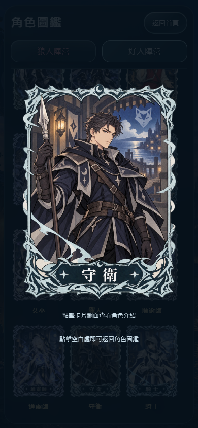
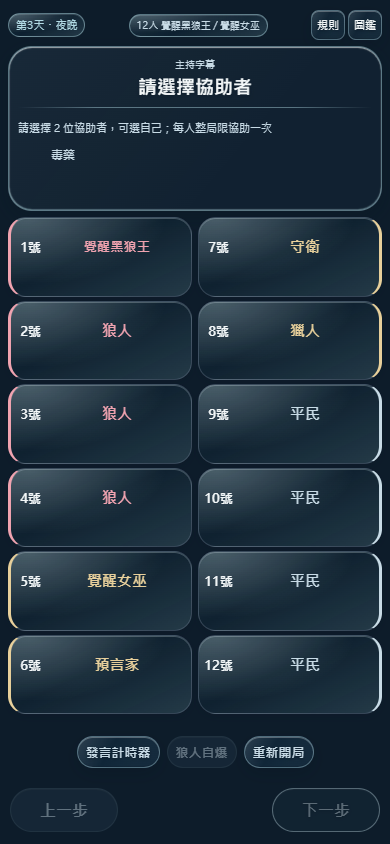

# 協助者小字幕與最新角色圖片同步

分支 `feat/eclipse-host-app`。本輪同時處理使用者核准的小字幕及「最新圖片是不是還沒更新」的核對結果。

## 結果與原因

已將 Drive「月下議會／職業／第三版-新」的 35 個現有角色 PNG 全數下載並核對 SHA256。**7 個來源與網站發布清單不相符、28 個相符**；另實際下載正式站舊 WebP，確認七個發布檔仍對應舊版，不把原因只歸咎手機快取。

| 角色 | 本輪同步 |
|---|---|
| 守衛 | 最新核准的無盔、無盾、整理髮型與深色服裝版本 |
| 守墓人、獵魔人、機械狼、種狼、舞者、假面 | 最新核准的外框與名稱底板配色版本 |

來源 ID、修改時間、原／新 SHA256：[35 張素材核對](catalog-source-audit.json)；衍生檔尺寸、位元組及 SHA256：[發布清單](catalog-v2-assets.json)；[更新前正式站七張雜湊](helper-art-sync-evidence/published-before.json)。未新增未實作的角色或板子。

## 修改檔案與界線

- `public/app.js`：只新增 helpersNeeded 匯入及協助者選擇頁 hint。已選毒藥顯示「請選擇 X 位協助者，可選自己；每人整局限協助一次」；X 依調毒次數為 1／2／3，不依夜晚編號。未用毒顯示「本晚未使用毒藥，按下一步」。原不足／耗盡原因優先，沒有新增已選進度。
- `public/catalog-v2.js`：七角色 full／thumbnail 切至新 `*-v2.webp`；列表、翻卡、線上卡及復盤沿用共用映射，沒有重做布局。
- `public/art/catalog-v2/`：只新增七張 full 與七張縮圖。由最新 PNG 轉為 1060×1484／420×588 WebP，保留透明度、不重繪；quality 92／88、method 4、exact alpha。新增約 4.57 MB，選用資源按需與背景漸進載入。
- `public/sw.js`、`public/cache-manifest.js`：cache council-v22-32，新增 14 個可選資源，保留七張舊版的大／小圖；244 項素材雜湊。CORE 優先、每批兩個與背景下載策略不變。
- `docs/catalog-v2-assets.json`、`docs/catalog-source-audit.json`：來源與發布檔可核對記錄，不含暫時下載憑證。
- `scripts/helper-art-sync-ui.mjs`、`scripts/helper-art-sync-offline.mjs`：小字幕、七角色歷史快照圖片及真實 SW 離線定向驗證。既有圖鑑 UI 的 servedAssetHashes 改為由 manifest 計算（35×2），測試標題移除失準的 66；原斷言保留。
- README、DESIGN、AGENTS、`docs/akw-spec.md`：更新現行版本、小字幕及正式來源；歷史紀錄保留其當時版本，不把舊規格當現行要求。

遊戲引擎、技能資格、選擇／下一步判定、藥物消耗、投票、計時、存檔格式與回退不變；不修改 Supabase、Realtime、Edge Functions、Google Drive 或 main。

## 本機測試

| 實際指令 | 通過 | 失敗 | 跳過 |
|---|---:|---:|---:|
| `npm test` | 1178 | 0 | 0 |
| `node --test test/catalog-v2.test.js test/skill-v2.test.js` | 22 | 0 | 0 |
| `node scripts/catalog-v2-ui.mjs` | 111 組 | 0 | 0 |
| `node scripts/online-card-art-ui.mjs` | 41 組 | 0 | 0 |
| `node scripts/recap-identity-days-ui.mjs` | 13 組 | 0 | 0 |
| `node scripts/helper-art-sync-ui.mjs` | 13 組 | 0 | 0 |
| `node scripts/akw-ui.mjs` | 13 組 | 0 | 0 |
| `node scripts/helper-art-sync-offline.mjs` | 8 組 | 0 | 0 |
| `node scripts/update-cache-manifest.mjs --check` | 244 項 | 0 | 0 |

[完整規則結果](helper-art-sync-evidence/npm-local.json) · [圖鑑](helper-art-sync-evidence/catalog-local.json) · [線上卡](helper-art-sync-evidence/online-local.json) · [復盤](helper-art-sync-evidence/recap-local.json) · [提示與歷史圖片](helper-art-sync-evidence/hint-art-local.json) · [原新板流程](helper-art-sync-evidence/akw-local.json) · [離線](helper-art-sync-evidence/offline-local.json)。

圖鑑涵蓋 320／375／390／430、短螢幕、橫向、平板與桌面、150% 字體、翻牌與原圖回退。線上卡以虛構 API／Auth／Realtime 驗證全部 35 角色，含蓋牌清空及授權失敗，不宣稱是真人十二端或後端連線測試。七角色復盤圖以保存的施術者／目標 role ID 解析新版，前後快照資料一致；另沿用完整復盤既有 UI 回歸。離線測試核對新版 14 個資源在 council-v22-32 的 SHA256，斷網後七角色仍能載入與翻卡。

[保留核對](helper-art-sync-evidence/preservation.json)：原 26 SVG、35 原 PNG、70 舊 WebP 均逐位元組未變；九個相關遊戲／復盤／線上／計時模組無語意差異。首輪 WebP method 6 輸出過慢，停止的是自建素材轉檔程序，改用 method 4 完成；沒有把中斷測試列為通過。

## 發布與發布後驗證

功能提交：`a0498dd51a68efc6c7ae36ff6671c7a23c6e7f04`。既有工作流程 [Pages run 40471552252](https://github.com/jia0796/wolf_Emcee/actions/runs/40471552252) 的 build 與 deploy 皆成功，網站：[WolfCue 狼序](https://jia0796.github.io/wolf_Emcee/)。[發布證據](helper-art-sync-evidence/deployment.json)；[CI 規則測試 1178／0／0](helper-art-sync-evidence/npm-ci.json)。

正式站 `app.js`、`catalog-v2.js`、`sw.js`、`cache-manifest.js` 及 14 張新 WebP，共 **18 個發布檔案 SHA256 全部相符**；文字檔只正規化換行，圖片逐位元組核對。[正式站雜湊](helper-art-sync-evidence/release-hashes.json)。

以下測試均在 Pages 成功後執行，瀏覽器 `UI_BASE=https://jia0796.github.io/wolf_Emcee/`，按順序完整完成；199 組皆有最終結果檔，沒有中斷／逾時結果列入通過。

| 部署後實際指令 | 通過 | 失敗 | 跳過 | 證據 |
|---|---:|---:|---:|---|
| `npm test` | 1178 | 0 | 0 | [結果](helper-art-sync-evidence/npm-postdeploy.json) |
| `node scripts/catalog-v2-ui.mjs` | 111 組 | 0 | 0 | [結果](helper-art-sync-evidence/catalog-live.json)，含 35 角色大圖／縮圖共 70 個實際 HTTP SHA256 |
| `node scripts/online-card-art-ui.mjs` | 41 組 | 0 | 0 | [結果](helper-art-sync-evidence/online-live.json) |
| `node scripts/recap-identity-days-ui.mjs` | 13 組 | 0 | 0 | [結果](helper-art-sync-evidence/recap-live.json) |
| `node scripts/helper-art-sync-ui.mjs` | 13 組 | 0 | 0 | [結果](helper-art-sync-evidence/hint-art-live.json) |
| `node scripts/akw-ui.mjs` | 13 組 | 0 | 0 | [結果](helper-art-sync-evidence/akw-live.json) |
| `node scripts/helper-art-sync-offline.mjs` | 8 組 | 0 | 0 | [結果](helper-art-sync-evidence/offline-live.json)，真實 cache32 的 14 張新圖核對後斷網翻卡 |

正式站確認圖鑑、線上卡正面、復盤都採最新共同映射。測試沒有連線或修改真實房間；角色權限與 API 為隔離的虛構測試替身。原有線上卡外框／卡背、復盤融合及舊身分快照維持原樣。

## 尚未驗收

- iPhone Safari、安裝 iOS PWA、Android、低階裝置：**待真機驗收**。Edge 的手機尺寸／離線模擬不替代真機。
- 本輪未重做 Supabase 真人十二端連線、安全測試或雲端資料庫測試，因未修改後端。
- 原有舊 PWA 在真機上的更新時機仍待驗收；不要求清除 localStorage／使用者對局。

## 備份與安全回退

施工前乾淨基準 `d2165a7ff78515d4f3f4d0a6a8eec19e4c7fdcc8`。已建立、推送並核對遠端 `backup/pre-akw-helper-hint` 指向相同 SHA；原有全部備份保留。

回退以 `git revert a0498dd51a68efc6c7ae36ff6671c7a23c6e7f04` 建立新提交，重跑測試再發布；不 reset、不 force push、不改存檔。若已發布 cache32，回退時需另提升 SW cache 版本，使已安裝裝置取得回退檔；不能直接沿用已存在的 cache31／32 名稱。原圖及舊 WebP 仍可用，不需刪除使用者紀錄。

## 畫面

