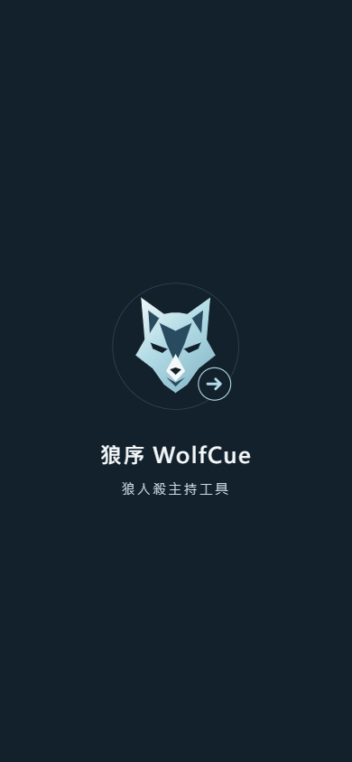
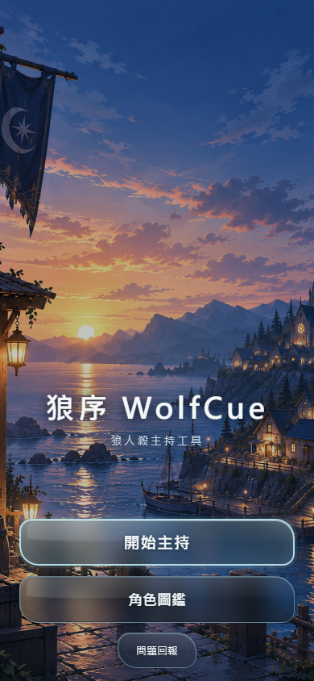

# WolfCue 開場動畫 OPEN-01～OPEN-10 部署與驗收報告

2026-10-21。依使用者最新「依照指示完成動畫並部署」授權完成；未代選 OPEN-11 A／B 策略。

## 交付與回退基準

- 正式網站：https://jia0796.github.io/wolf_Emcee/
- 規格／修改前 Commit：`43b9b1bbf48b411ee8b51c246c07eac04f0b2b7c`。
- 遠端備份：`backup/pre-opening-20261021`，已用 `git ls-remote` 確認指向修改前 Commit。
- 實作分支：`feat/opening-20261021`；正常推送到原 Pages 發布分支 `feat/eclipse-host-app`，未修改 main、未強制推送。
- 實作 Commit：`b72b08fd037ca1ef8a9da5a524756ed2f28a9a94`。
- [GitHub Pages 部署成功](https://github.com/jia0796/wolf_Emcee/actions/runs/39568918152)。部署後核對 `app.js`、`b3-ui.js`、`b3.css`、`wolfcue-mark.svg`、`sw.js` 五個檔案 SHA-256 均與提交一致：[發布證據](opening-evidence/deployment.json)。

## 逐項結果

| 項目 | 實作與驗證 |
|---|---|
| OPEN-01 品牌 | 使用原 `wolfcue-mark.svg`，原檔未更動；深藍 #13212D、冰藍 #B2DBE5。 |
| OPEN-02 啟動限定 | 僅可靠辨識為新分頁且進首頁時啟動；主持、線上恢復及內部返回跳過。 |
| OPEN-03 1.8 秒 | 描邊、原徽章、主副標依序出現，最後 350ms 淡出；總長 1800ms，不提供手動跳過。 |
| OPEN-04 描邊 | 從原 SVG 複用狼首輪廓，沒有另畫標誌；動畫結束完整顯示原徽章。 |
| OPEN-05 首頁銜接 | 首頁原海邊村莊背景；未下載時深藍首頁先可操作，圖片到達後獨立柔和淡入。舊圖閃現回歸通過。 |
| OPEN-06 雙平台 | 共用瀏覽器／standalone 啟動判定；桌面與離線可用，原生 PWA 啟動與實體行動裝置待驗收。 |
| OPEN-07 異常解除 | JS 錯誤、缺失動畫 CSS、徽章失敗、動畫取消均解除；另有獨立 2500ms watchdog。正常完成計時器被停用的注入測試通過。 |
| OPEN-08 每分頁 | 分頁級 sessionStorage，不用全域 localStorage 已播旗標；兩個新分頁獨立播放，刷新、BFCache、背景恢復及複製旗標跳過。 |
| OPEN-09 靜音文字 | 主標「狼序 WolfCue」、副標「狼人殺主持工具」；無音訊程式或素材。 |
| OPEN-10 操作鎖 | 覆蓋期間背景 inert、焦點隔離及捕獲輸入；沒有點擊排隊，跨動畫結束的長按釋放也不穿透。解除後原操作恢復。 |

原始狼徽載入失敗、內容無效或超過早期進場時間（600ms）才到達時，跳過剩餘演出；不為了等待素材延長開場。初始化不可靠或儲存不可用時也跳過。Web 無法保證辨識所有 iOS 冷啟動與休眠恢復情境，原生系統啟動畫面不屬於此次動畫。

## 檔案與範圍

- `public/b3-ui.js`：純呈現層啟動判定、動畫與解除；首頁圖片晚到時的淡入。
- `public/b3.css`：覆蓋層、描邊、文字與初始中性背景；不改原按鈕／卡片版面。
- `public/app.js`：原初始化完成、目的頁確認後呼叫動畫安裝函式。
- `test/opening.test.js`：12 項新分頁與跳過條件測試。
- `scripts/opening-ui.mjs`：55 項瀏覽器開場／異常／恢復／輸入測試。
- `scripts/opening-offline-ui.mjs`：4 項實際離線新分頁與桌面觸控模擬測試，並拍攝三階段畫面。
- `README.md`、本報告與 `docs/opening-evidence/`：部署後完成狀態、可重現指令、測試與截圖證據。

[未變更檔案核對](opening-evidence/unchanged.json) 包含原狼徽、全部現有技能 SVG、遊戲引擎、角色資料、死亡／投票／復盤／計時器／線上模組與 Service Worker。存檔仍 v22、快取仍 `council-v22-14`。本輪沿用既有 JS／CSS 網路更新與離線回退機制，沒有新增快取策略或遷移遊戲資料。

## 實際測試

| 指令／測試 | 本機 | 正式站 |
|---|---:|---:|
| `npm test` | 875 通過，0 失敗／跳過／取消 | Pages CI 同一提交通過 |
| `node --test test/opening.test.js test/b3-ui.test.js` | 16 通過 | — |
| `node scripts/opening-ui.mjs` | 55 通過 | 55 通過 |
| `node scripts/b3-r10-r16-ui.mjs` | 50 通過 | 本輪未重跑此完整腳本 |
| `node scripts/cold-start-background-ui.mjs` | 23 通過 | 23 通過 |
| `node scripts/opening-offline-ui.mjs` | 4 通過 | 4 通過 |

`npm test` 包含 28 板各 18 種種子，共 504 場完整模擬對局、55,875 次操作。[單元摘要](opening-evidence/unit-summary.json)／[完整輸出](opening-evidence/unit-tests.txt)。

瀏覽器使用桌面 Edge／Playwright，320×568、375／390／430×844 等 viewport。正常開場觀測約 1.79～1.80 秒；獨立安全上限測試刻意停用正常解除計時器，約 2.5 秒解除。背景與錯誤測試透過資源攔截／事件注入；離線測試實際切換 browser context 為 offline，使用原 Service Worker 快取。沒有操作真實線上房間或 Supabase 資料。

首次本機腳本因測試伺服器尚未啟動而中止；啟動後完整重跑。冷啟動第一輪因截圖等候字型 10 秒逾時中止，不列為通過；設定 `PW_TEST_SCREENSHOT_NO_FONTS_READY=1` 後完整重跑通過，未刪減任何功能斷言。最終結果檔均完整結束，沒有未解決的自動化失敗。

可重跑環境變數：`COUNCIL_PLAYWRIGHT_MODULE` 指向已安裝 Playwright；開場／R16 腳本使用 `UI_BASE`，開場證據使用 `OPEN_OUTPUT`；冷啟動腳本使用 `COUNCIL_URL`、`COUNCIL_OUT`、`COUNCIL_BASELINE=0`（本輪不重演歷史版本）、`PW_TEST_SCREENSHOT_NO_FONTS_READY=1`。所有腳本預設可指向本機；正式站需設定 URL。

證據：[本機開場](opening-evidence/local/results.json) · [正式站開場](opening-evidence/live/results.json) · [既有 UI 回歸](opening-evidence/r16-local/results.json) · [本機冷啟動](opening-evidence/cold-local/results.json) · [正式站冷啟動](opening-evidence/cold-live/results.json) · [本機離線](opening-evidence/offline-local/results.json) · [正式站離線](opening-evidence/offline-live/results.json)。

## 待真機驗收與限制

- iPhone Safari／iOS 安裝 PWA：原生啟動畫面、真正冷啟動與系統保留程序、網址列、安全區與實際手勢。
- Android／低階手機：效能、背景切回及真實觸控。
- 桌面注入的 visibility／BFCache 與觸控模擬不代替上述真機驗收。
- OPEN-11 驗收策略仍未選定；本輪依最新直接授權部署，沒有將未測項目宣告通過。
- 本輪沒有發現尚存功能 Bug；不代表所有裝置均已驗收。

## 安全回退

在乾淨的最新發布分支上，以反向提交撤回本輪程式；不重置歷史、不覆寫備份或其他後續提交：

```powershell
git fetch origin
git switch feat/eclipse-host-app
git pull --ff-only origin feat/eclipse-host-app
git revert b72b08fd037ca1ef8a9da5a524756ed2f28a9a94
# 檢查差異、處理若有的後續衝突，重新執行 npm test 與適用 UI 驗證
git push origin feat/eclipse-host-app
```

原版在遠端 `backup/pre-opening-20261021`。README 完成狀態需隨實際回退另行更新，不要把備份整棵目錄覆蓋至新版本。

## 正式站截圖

描邊：[outline.png](opening-evidence/offline-live/outline.png)




