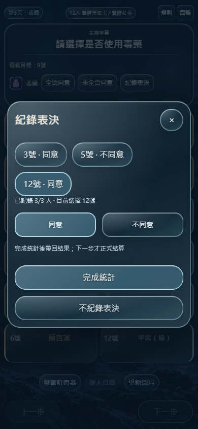
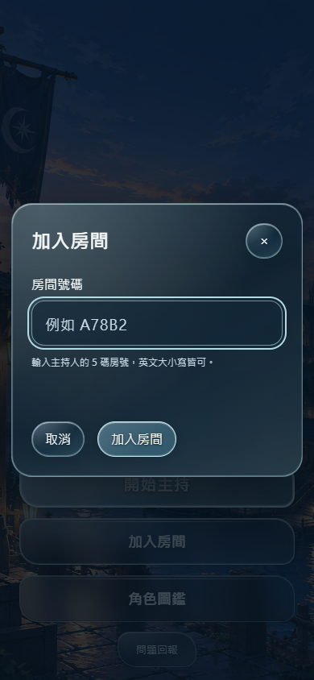

# 5 碼房號、夜序與覺醒女巫表決｜實作、部署與測試報告

日期：2026-11-06。使用者已授權部署。Supabase migration `20261106071704` 與 room Edge Function v5 已發布；網站由本次功能提交觸發 Pages。部署後證據將於完成後追加。未修改 main、Google Drive、角色圖片、遊戲數值或既有用戶／對局。

## 工作目錄與回退基準

所有程式及本文位於：
`C:/Users/laptop/.codex/.chatgpt-projects/g-p-6ab7d6c1ce448191aa4864889419a846/walf/`

原始測試輸出／手機截圖位於同層上級的 `output/room-code-nightorder/`；可隨儲存庫交付的結果與截圖副本位於 [room-code-nightorder-evidence](room-code-nightorder-evidence/)。

- 分支：`feat/eclipse-host-app`，開始時工作樹乾淨；本機與 GitHub 基準一致。
- 基準 SHA：`f70cdde48b1af4547ca6676f91cdac43ef13af20`。
- 已建立並查證遠端備份：[backup/pre-room-code-nightorder-20261106](https://github.com/jia0796/wolf_Emcee/tree/backup/pre-room-code-nightorder-20261106)。
- 本輪功能提交與 Pages 發布紀錄於部署後補記；以上 SHA 是施工前回退基準。
- 存檔仍 v22，發布 cache `council-v22-34`。

## 已實作

1. **首頁加入房間**：開始主持 → 加入房間 → 角色圖鑑；沿用原背景、按鍵大小／行距。房號欄有標籤、錯誤、加入中與防重複提交；可貼上、大小寫混用、去除前後空白。5 碼字元排除 I／L／O／0／1，例 `A78B2`。
2. **後端短房號**：另外保存短碼與 UUID 對照，不截斷／替換原 UUID、12 碼房號或邀請憑證。新／舊活動房都有短碼，建立衝突重試，原連結／QR 可用。未發牌且有空位才接受新成員；既有玩家以原 Auth 身分恢復。解散級聯刪除短碼，結束／過期不能再加入。角色仍依個人座位 lease 查詢。
3. **機通字幕**：首夜刪除額外學獵人手勢句，第二晚起刪除獵人閉眼後額外三句；學習、狼刀、技能資格不變。舊局及上一步取回已移除階段時安全映射到閉眼步驟；不刪歷史、不提前提交行動或結算。
4. **AKW 夜序顯示**：守衛 → 狼人 → 覺醒黑狼王親傳 → 覺醒女巫 → 預言家 → 獵人 → 協助者集體表決 → 天亮。僅補齊顯示，實際階段未調整。
5. **覺醒女巫紀錄表決**：移除模式／上一位下一位，先選協助者再選意見；自動跳下一位未填者，全部填完才能完成統計，仍需主持下一步正式結算。×／Escape 保留草稿，不紀錄表決清除個別票型。修改、取消、刷新及儲存失敗皆保留原安全語意。
6. **間距**：協助者按鍵相隔 10px，意見按鍵與底部按鍵相隔 12px；48px 觸控高度、全藍色系／米白字，視窗按內容縮短。移除舊版粉紅意見字色及 8px 的覆寫樣式。

## 實際測試結果

| 執行內容 | 通過 | 失敗 | 跳過 | 證據 |
|---|---:|---:|---:|---|
| 根目錄 `npm test` | 1185 | 0 | 0 | [完整輸出](room-code-nightorder-evidence/npm-test.txt) |
| backend `npm test` | 30 | 0 | 0 | [完整輸出](room-code-nightorder-evidence/backend-test.txt) |
| 新加入／表決／夜序 UI | 17 | 0 | 0 | [結果](room-code-nightorder-evidence/new-ui-results.json) |
| 既有覺醒黑狼王／女巫 UI | 13 | 0 | 0 | [結果](room-code-nightorder-evidence/akw-results.json) |
| 既有登入恢復 UI | 9 | 0 | 0 | [結果](room-code-nightorder-evidence/auth-results.json) |
| 既有線上卡／角色圖片 UI | 41 | 0 | 0 | [結果](room-code-nightorder-evidence/art-results.json) |
| 死亡技能／機通／狼弟 UI | 30 | 0 | 0 | [結果](room-code-nightorder-evidence/dsk-results.json) |
| Service Worker／離線主持 | 3 | 0 | 0 | [結果](room-code-nightorder-evidence/offline-results.json) |

共 **113 組瀏覽器檢查**；用獨立無頭 Edge，手機視窗包含 320×568、390×844、430×932，以及 844×390 橫向。既有 AKW 測試另含 375×667／1024×768。截圖已人工檢查，DOM 量測確認按鍵間距、縮短高度及按鍵未超出可視區。

後端 30 項包含 11 項 PGlite 真實 PostgreSQL SQL 檢查、9 項新 Edge 輸入／路由／429 檢查，以及原 10 項測試。SQL 實際套用既有 migration、虛構目錄及新 migration，驗證舊資料保留、撞碼重試、10／12 座位發牌、角色權限、限流、過期／解散與回退。Auth／Realtime 使用介面替身；PGlite 的排程不是多資料庫連線競爭測試。

第一次無頭 Edge 啟動受到 Windows 沙箱限制，第一次既有 UI 回歸因沙箱內外 localhost 不互通而未執行完成；改以隔離無頭瀏覽器與同權限本機伺服器後重跑通過。視覺檢查另修正原 CSS 的自動高度撐滿與 input 160px 限寬。以上中斷沒有計入通過數。離線腳本沿用的「actual deployed SW」結果標籤，本輪 URL 是 localhost，**不是正式站測試**。

## 安全驗收與待測

已通過：匿名身分仍需 Auth；後端不信任前端 roomId 覆蓋短碼；對照與限流表啟用 RLS 並禁止客戶直接讀寫；短碼加入不回傳邀請憑證／其他人角色；非成員不能只用 UUID 加入；成員重連不需公開邀請；原主持權限、私人角色 lease、一次發牌、原連結保持有效；新 RPC 每身分每分鐘 6 次、每小時 30 次的交易內限流，無效輸入亦計數；Edge 回 429。

限制與未驗收：
- **完整本機 Supabase Auth／Realtime、多連線 SQL 並發、部署後真實連線尚未驗收**。Docker CLI 存在，但 Docker Desktop Linux engine 管道沒有啟動。沒有用正式用戶或房間代替本機測試。
- 限流按 Auth 身分，不能宣稱阻擋換身分的分散式猜碼。既有匿名註冊／CAPTCHA／IP 限制設定沒有修改或重新驗收；5 碼本質上比原長邀請憑證更易猜中。
- **iPhone Safari／iOS PWA／Android 真機未驗收**；桌面手機尺寸模擬不等於實機。
- 雲端追加 migration 與 Edge 已發布，網站發布後另核對入口與檔案雜湊。

## 檔案清單

- 首頁／線上：`public/index.html`、`data.js`（僅 HOME_ACTIONS）、`app.js`、`online.js`、新增 `join-room.js`、`online.css`、`sw.js`。
- 夜序／表決：`public/engine.js`、`akw-ui.js`、`liquid-glass.css`、`recap-ui.css`（移除被取代的 AKW 專用樣式）。
- 後端：`backend/supabase/functions/room/index.ts`、`backend/supabase/migrations/20261106071704_short_room_codes.sql`、`backend/rollback/20261106-short-room-codes.sql`。
- 新測試：`test/room-code-nightorder.test.js`、`backend/tests/short-room-code.test.mjs`、`backend/tests/short-code-edge.test.mjs`、`scripts/room-code-nightorder-ui.mjs`。
- 更新既有定向測試：`test/dsk-mec-bro.test.js`、`test/takeover.test.js`、`scripts/dsk-mec-bro-ui.mjs`，以新裁定取代舊字幕預期，保留技能與回退檢查。
- 文件：`README.md`、`DESIGN.md`、`AGENTS.md`、`backend/README.md`、`docs/current-rules.md`、`docs/akw-spec.md`、本文及 evidence。歷史報告不覆寫。

## 發布與安全回退方式

發布前先完成上述 Supabase 實際整合驗收；之後依序為追加 migration → 更新 room Edge Function → 發布前端，驗證短碼／原連結、兩種人數、私有頻道及角色隔離。原網站先部署新前端而後端未上線會造成加入失敗，因此不可顛倒。

回退應比對備份基準並保留後續使用者變更，不用 `reset --hard` 或強制推送。發布後以新的 revert 提交回退相應功能；回退網站時優先保留相容的追加後端。**不要清除使用者、房間或對局來回退。**

[SQL 回退草稿](../backend/rollback/20261106-short-room-codes.sql) 有活動房間保護，尚有 waiting／dealt 房就拒絕執行；PGlite 實測阻擋有效，房間不活躍後僅移除新增短碼／限流結構，原房間與 Auth 數量不變。正式需要回退 DB 時，用 CLI 建立新的回退 migration，不修改已執行歷史；保留舊網址／原邀請兼容。回退後短碼入口停用，不承諾原短碼可繼續使用。

## 預覽

## 雲端驗證進度

- 已實際驗證建立房間重試保留同一 UUID／短碼、拒絕陌生成員只用 UUID 加入，以及 12 個匿名身分以小寫短碼／原邀請連結並行加入。
- 第一輪 Realtime 訂閱失敗時，服務日誌顯示初始化與 MissingPartition；第二輪已訂閱成功，但 1.2 秒內未收到通知。資料庫確認已產生 25 筆私有 changed 訊息。不能據此宣稱端到端即時通知通過。測試已改等待實際通知，最長 15 秒，保留 SDK 自動重連。
- 再次批量建測試身分時收到 Auth 429；停止大量建立身分，沒有提高匿名註冊限額。10／12 人雲端完整發牌及即時通知尚未完成，單測與本機 UI 通過不替代此驗收。第一次、第二次及限流中斷各自保留結果，不計為完整通過。
