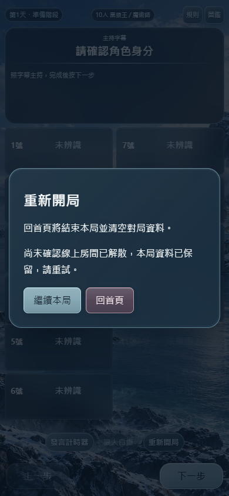

# 線上房間實體刪除與玩家退出｜部署報告

2026-10-21。使用者已確認「現在修正並部署」；本輪僅處理房間關閉與離開，不實作仍待授權的 HOST 2.0 項目。

## 已完成

- 等待房間「解散房間」會實體刪除房間、授權、座位、邀請、發牌交易及角色資料。
- 發牌後，主持人透過原「重新開局 → 回首頁」明確結束本局時，先完成伺服器刪房，再清本機對局。原正式終局通知也會刪除該局線上資料，本機復盤保留。
- 房間關閉時玩家立即蓋牌、移除角色 DOM、退出圖鑑／角色頁、清除該房間連結與邀請並回首頁。多分頁同步退出；斷線玩家重連後退出。
- 主持端刪除失敗或回應遺失時保留原對局／回退歷史與房間參照，顯示重試。實際已刪除時重試可安全確認，不會重開房間或影響新的房間。
- 清除舊房號與 QR 畫面，避免下一次建房短暫顯示前一間資料。相同主持人可立即再開房。

不刪除 Supabase Auth 帳號，不批次刪除其他既有房間；遊戲規則、角色、投票、復盤模型、計時器、原圖片／SVG、存檔 v22 與快取策略未改。

## Git 與部署

- 修改前：`fc206978520b04bb850444fb84d02b4f7c9e32cf`。
- 遠端備份：`backup/pre-room-dissolve-20261021`，保留上述基準。
- 實作：`4b06eb3288262966ba81f1f5d8d0f931363bf196`。
- 分支：`feat/room-dissolve-20261021`，正常推送至發布分支 `feat/eclipse-host-app`；沒有改 main、重寫歷史或 force push。
- [Pages 部署成功](https://github.com/jia0796/wolf_Emcee/actions/runs/39598524191)，網站：https://jia0796.github.io/wolf_Emcee/
- Supabase `wolfcue-online`：migration `20261021110926 / room_dissolve_delete`、`room` Edge Function v2 已部署。
- [正式站檔案雜湊](room-dissolve-evidence/deployment.json)：HTML、App、線上模組及 Service Worker 四個檔案均符合發布提交。

Migration 工具兩次回傳 `Invalid or expired requestState`，查證均未執行後，改用同一授權連線在 SQL 交易內套用已測腳本，確認函式存在及路由正確後，登錄相同 migration 版本與原始 statements；雲端 migration 清單已核對。不是把失敗呼叫列為部署成功。Edge 原有自訂 JWT 驗證、CORS、private Realtime 與 Auth 設定不變。

## 修改檔案

| 檔案 | 用途 |
|---|---|
| `public/online.js` | 刪房確認、私有終止訊號、找不到房間時退出、清理房間參照／網址／角色／QR；既有發牌與座位判定沿用。 |
| `public/app.js` | 主持確認回首頁時等待刪除成功；防重複提交，失敗保留本局。 |
| `public/index.html` | 原確認彈窗加入失敗重試訊息區，不改原按鈕及字幕。 |
| `backend/supabase/functions/room/index.ts` | 已驗證使用者遇到房間無法存取時，回傳可辨識的 `ROOM_UNAVAILABLE`；不洩漏 SQL 細節。 |
| `backend/supabase/migrations/20261021110926_room_dissolve_delete.sql` | 房主限定、鎖房交易、關閉通知與外鍵連鎖刪除；缺失 UUID 的冪等回應；從原 command 輸入驗證後分流。 |
| `backend/supabase/rollback-room-dissolve.sql` | 回退既有 command 與新私有 helper 的獨立腳本，不放進 migrations 自動執行。 |
| `backend/tests/integration/room-closure.test.mjs` | 12 項新增精準資料庫測試。 |
| `backend/tests/integration/backend.test.mjs`、`edge-realtime.test.mjs` | 僅更新已被本次新定案取代的關閉結果斷言，增加實體消失與拒絕舊存取檢查；原授權／角色／併發斷言保留。 |
| `backend/scripts/room-closure-ui.mjs` | 本機及正式站完整測試，含網路失敗、成功回應遺失、圖鑑／多分頁／離線與重新建房。 |
| `README.md`、`backend/references/online-deal-final.md`、本報告及證據 | 同步最新解散規格、完成狀態、實際測試與回退方式；HOST 待實作規格不變。 |

## 實際測試結果

| 測試／指令 | 結果與範圍 |
|---|---|
| `npm test` | **875 通過、0 失敗／跳過／取消**。含 28 板 ×18 種子、504 場完整模擬、55,875 次操作。 |
| `node --test tests/integration/room-closure.test.mjs tests/integration/backend.test.mjs`（backend） | **25 通過**：原資料庫13項＋新增12項。 |
| 最終 migration 再跑 `room-closure.test.mjs` | **12 通過**，包含相容舊客戶端的空 seats 終止回應。 |
| `edge-realtime.test.mjs`＋`cleanup.test.mjs` | **6 通過**：真實本機 JWT、Edge、私有頻道、拒絕偽造廣播及原過期清理。 |
| `node scripts/local-cli.mjs dbtest` | pgTAP **10 項計畫通過**。 |
| `node --test tests/channel.test.mjs` | **1 通過**，原私有頻道客戶端回歸。 |
| `node scripts/room-closure-ui.mjs` | 本機 **17 通過**，含 12 人發牌後刪房。 |
| `CLOSURE_LIVE=1 node scripts/room-closure-ui.mjs` | 正式站 **17 通過**，含 10 人實際雲端發牌與刪房。 |
| 原 `node scripts/online-ui.mjs` | **27 通過**，10 人完整原流程、翻牌、圖鑑、刷新、終局與多尺寸。 |
| 原 `scripts/b3-r10-r16-ui.mjs` | **50 通過**，主持、投票／PK、計時器、確認、復盤、手機窄螢幕及舊存檔。 |
| 本機完整回退 SQL → 再套用修正 | 通過；[演練結果](../backend/reports/closure-rollback.json)，未對雲端執行回退。 |
| `node --check`／`git diff --check` | 通過；此純 JS 專案沒有獨立 TypeScript／App 建置腳本，Edge TS 已在本機 Deno Runtime 與雲端實際執行。 |

不同範圍及重跑不相加當作不同案例。證據：[App 輸出](room-dissolve-unit-tests.txt)／[App 摘要](room-dissolve-evidence/unit-summary.json)、[資料庫](../backend/reports/closure-database-console.txt)、[新增精準測試](../backend/reports/room-closure-results.json)、[Edge](../backend/reports/edge-realtime-results.json)、[本機 UI](room-dissolve-evidence/local/results.json)、[正式站 UI](room-dissolve-evidence/live/results.json)、[既有主持 UI](room-dissolve-evidence/existing-ui/results.json)、[既有線上 UI](room-dissolve-evidence/existing-online/ui-results.json)。

主要驗收項目如下；各項實際環境依上表，資料庫競態／回滾限本機，UI 專項於兩環境完整執行：

- 等待房／已發牌房刪除，房主權限與原 `end` 的 dealId 驗證。
- 8 個關閉重送、與發牌／選座併發、交易回滾、舊刪除重試不會碰新房。
- 原 lease、舊連結、直接角色讀取與新私有訂閱不能恢復已刪房。
- 已翻牌、圖鑑、同身分多分頁、重整、離線後重連退出。
- 請求在到達伺服器前失敗時保持本局；伺服器刪除已成功但回應遺失時保持本局，下一次冪等確認成功才清本機資料。
- 成功關閉後同一主持人能建立新房；所有本輪新建測試房均已清除。

資料庫精準併發／回滾只在本機驗證，不宣稱在雲端注入 SQL 故障。正式站 UI 使用本輪自建虛構玩家，沒有讀取真人角色或操作其他人的房間。

### 正式站實體刪除證據

[雲端查證](room-dissolve-evidence/cloud-deletion-proof.json)：本輪3間自建房在 `rooms`、`room_access`、`room_seats`、`room_secrets`、`deal_transactions`、`player_roles` 全部 **0 筆**。僅查證這三間，未批次清理歷史房間。

### 過程中發現與修正

- 原「回首頁」只清除本機資料，留下 dealt 房間而阻塞再建房：已修復。
- 關閉後新房仍短暫顯示舊 QR／房號：專項測試發現後修復，完整重跑通過。
- 邀請測試最初在同一文件只改 hash，沒有重新執行 App 入口；修正測試為真的重新開啟邀請文件，原「舊邀請不能恢復」斷言保持。未擴充修改同頁 hash 導覽功能。
- 本機舊 migration 歷史與既有索引不一致：只重建未連結雲端的本機虛構資料庫，再從完整 migrations 與 seed 驗證。雲端沒有 reset。
- 回退腳本首次本機演練發現多餘前綴字元，修正後已完整驗證原函式還原與修正重新套用。雲端未執行回退。
- 首次工具／測試中止不列為通過，以上結果均以完整結束的最後結果檔為準。

## 安全與待驗收

新 helper 在私有 schema，固定空 `search_path`，不能由 anon／authenticated／service_role 直接 EXECUTE；只從原有已驗證 JWT 的 command 呼叫，對存在房間必須驗證房主。刪房使用原房間列鎖與既有 cascade 關聯；通知不含職業、憑證或角色名單。不存在的 UUID 只回傳最小已刪除狀態，不能影響新建 UUID。

雲端 Advisor 已檢查，沒有為了消除警告擴充權限或變更無關設定。[完整 Advisor 記錄](room-dissolve-evidence/cloud-advisors.json) 仍列：

- 4 個 private 表啟用 RLS 但沒有客戶端 policy 的 INFO：目前以無直接資料權限保護，並非新增公開存取。[說明](https://supabase.com/docs/guides/database/database-linter?lint=0008_rls_enabled_no_policy)
- Anonymous Access Policies WARN：App 本來採 Auth 匿名登入，但仍須經使用者／房間授權；cron 的 anon／authenticated schema USAGE 已查證為 false，未因本輪放寬。[說明](https://supabase.com/docs/guides/database/database-advisors?queryGroups=lint&lint=0012_auth_allow_anonymous_sign_ins)
- 密碼外洩保護未啟用 WARN：未改 Auth 設定，目前 App 不提供密碼登入。[設定說明](https://supabase.com/docs/guides/auth/password-security#password-strength-and-leaked-password-protection)
- 2 個未使用索引 INFO：未移除既有外鍵支援索引。[說明](https://supabase.com/docs/guides/database/database-linter?lint=0005_unused_index)

桌面 Edge／Playwright 的 viewport、模擬離線與 visibility 不等於真機。iPhone Safari、iOS 安裝 PWA、Android、低階裝置及真實網路切換均**待真機驗收**。離線裝置無法在沒收到訊息時立即退出，恢復連線／權限查證後退出。已開著舊版 JS 的分頁需重新整理取得本次修正。

## 安全回退

回退前保留現在的後續提交，在最新乾淨發布分支使用反向提交，不能 reset／force push：

```powershell
git fetch origin
git switch feat/eclipse-host-app
git pull --ff-only origin feat/eclipse-host-app
git revert 4b06eb3288262966ba81f1f5d8d0f931363bf196
# 若後續文件或測試有衝突，檢查並保留不相關後續修改
# 重跑 npm test 與適用 UI 測試後再推送
git push origin feat/eclipse-host-app
```

雲端另需在明確回退決策下執行 `backend/supabase/rollback-room-dissolve.sql`，並重新部署備份版 `room/index.ts`；不要把回退腳本放入新環境自動 migration。還原程式前應評估是否重新引入本次阻塞建房問題。原程式在遠端 `backup/pre-room-dissolve-20261021`。

**程式／函式回退不能復原已刪除的房間、座位或角色資料。** 本次刪除是使用者確認的新行為；本機遊戲歷史／正式復盤不作為伺服器角色資料的備份或重建來源。

## 實際畫面

成功刪房後玩家退出：


模擬刪除失敗時，原對局仍在，確認視窗提供重試：


