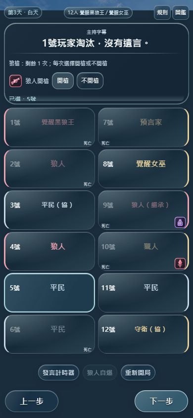
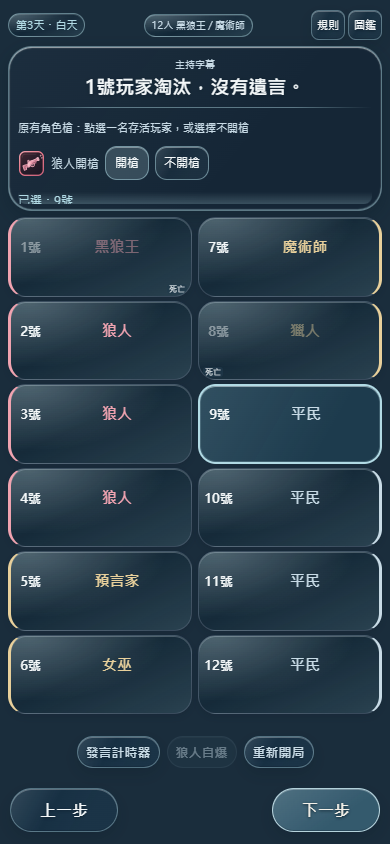

# 狼槍槍殺接續與待處理存檔修正

2026-10-26，`feat/eclipse-host-app`。本輪依使用者確認：覺醒黑狼王、狼槍繼承者及普通黑狼王，被獵人或其他狼槍帶走後，可按合法剩餘次數接續開槍。毒殺、自爆、既有禁技及正式終局停止仍保留。

## 問題與原因

使用者截圖的第 3 天：10 號獵人狼刀出局，槍殺 1 號覺醒黑狼王；1 號曾親傳一把給 9 號，因此本人仍有一把。4 號狼人存活，並非終局。

已用相同角色位置、先前死者、親傳與當晚毒藥／協助者設定重現。原程式只有放逐／基本狼刀能啟動覺醒狼槍，槍殺被拒；剩餘次數未消失。最初單測放逐與狼刀皆正常，截圖確認後才定位到槍殺分支。本輪是使用者後續明確裁定更新，不沿用原 README 的限定死因。

## 修改

- `public/akw.js`：把 `shot` 加入合法狼槍死亡來源，保留次數、毒殺及正式勝負檢查。
- `public/engine.js`：讀取目前待處理死亡頁／舊快照回退時恢復 `claw` 操作模式；即使舊畫面 operation 為 null，執行仍走專屬扣次分支，避免只顯示按鈕卻漏扣額度。只適配當前頁，不改寫所有歷史、不重算死亡。
- 普通黑狼王原本可被槍殺後使用原生一槍，程式無需擴寫；新增六種 10／12 人板資格及三種 12 人實際 UI 回歸，保留原規則及一次額度。
- `public/data.js`／`docs/akw-catalog-copy.json`：只將覺醒黑狼王說明更新為「因放逐、狼刀或槍殺出局」。
- `public/sw.js`：快取 council-v22-31；存檔版本仍為 v22，原 CORE 優先／兩資產漸進策略不變。
- README、AGENTS、DESIGN 的現行版本／規格已更新；舊發布報告明確標示後續更新入口。
- 新增 `test/wolf-gun-chain.test.js`、`scripts/wolf-gun-chain-ui.mjs`。原 AKW 毒殺優先等負向斷言保留；離線 UI 工具改為讀取目前 SW 版本，避免硬編碼舊 cache 名。

不修改投票、藥物結算、人物圖片、SVG、背景、其他角色技能、Supabase／Realtime／Edge Functions、Google Drive 或 main。新板已在線上目錄中，本次資格與主持存檔修正在前端，不需後端 migration。

## 備份與歷史

- 開工基準：`2e2171020a9435c2fc866d176e43e08135961f7a`，工作樹乾淨。
- 遠端 `backup/pre-wolf-gun-chain-20261026` 已建立、推送並核對指向該 SHA；其他所有備份保留。
- 功能提交：`0738fd17e298bfe67e2ec3e5dc10e3dd56afbec5`。
- [Pages run 40304368662](https://github.com/jia0796/wolf_Emcee/actions/runs/40304368662) 完整規則測試及發布成功。
- 回退使用新的 `git revert 0738fd17e298bfe67e2ec3e5dc10e3dd56afbec5` 提交及完整重測，不 reset／force push；尚在待開槍頁的對局應先完成或保存，再回退至舊規則，否則舊版會再次拒絕此槍殺來源。

## 本機測試

| 指令 | 通過 | 失敗 | 跳過 | 範圍 |
|---|---:|---:|---:|---|
| `node --test test/wolf-gun-chain.test.js test/akw.test.js test/akw-boundaries.test.js` | 44 | 0 | 0 | 截圖重現、24 項新回歸與 20 項原 AKW 測試 |
| `npm test` | 1178 | 0 | 0 | 所有 30 板各 18 種子完整局、舊局、死亡、勝負、投票、回退等 |
| `node scripts/wolf-gun-chain-ui.mjs` | 14 組 | 0 | 0 | 六種螢幕、舊畫面恢復、剩餘槍、連鎖、普通黑狼王三板、禁用及終局 |
| `node scripts/akw-ui.mjs` | 13 組 | 0 | 0 | 原親傳／協助者／表決／復盤／保存回滾 |
| `UI_BOARDS=12,kingGuard12,kingDream12,awakenedKingWitch12 node scripts/ui-regression.mjs` | 14 組 | 0 | 0 | 四板完整主持及共用圖鑑、警長、重開、離線；不是全部 30 板瀏覽器重跑 |
| `node scripts/update-cache-manifest.mjs --check` | 230 項 | 0 | 0 | 素材清單不變 |

[完整測試結果](wolf-gun-chain-evidence/npm-local.json) · [槍殺 UI](wolf-gun-chain-evidence/chain-ui-local.json) · [原 AKW UI](wolf-gun-chain-evidence/akw-ui-local.json) · [四板主持 UI](wolf-gun-chain-evidence/host-ui-local.json)。

新測試最初重現了覺醒狼槍拒絕槍殺的失敗；另校正兩個新測試對原流程的誤判（正式終局不使用主持字幕、明確不開槍不寫空槍復盤），沒有刪除或改弱舊角色／死亡／票權／結果斷言。最終結果以完整結束檔為準，逾時與未完成不算通過。

## 舊局使用

若仍停在截圖的 1 號待處理死亡頁，取得新版後重新整理，可直接恢復剩餘一槍。若已按下一步，可用原「上一步」回到該死亡頁；不會自動倒退對局，也不會把已完成／缺失的技能補成已發動。回退及刷新均保留原親傳名單、死亡來源、已用次數及復盤。

## 發布後驗證

網站：[WolfCue 狼序](https://jia0796.github.io/wolf_Emcee/)。已發布 `0738fd17e298bfe67e2ec3e5dc10e3dd56afbec5`；[Pages 成功紀錄](https://github.com/jia0796/wolf_Emcee/actions/runs/40304368662)。

| 部署後實際測試 | 通過 | 失敗 | 跳過 | 證據 |
|---|---:|---:|---:|---|
| `npm test` | 1178 | 0 | 0 | [結果](wolf-gun-chain-evidence/npm-postdeploy.json) |
| 正式站槍殺接續 UI | 14 組 | 0 | 0 | [結果](wolf-gun-chain-evidence/chain-ui-live.json)；包含截圖相同配置、舊局刷新／回退、普通黑狼王三板 |
| 正式站原 AKW UI | 13 組 | 0 | 0 | [結果](wolf-gun-chain-evidence/akw-ui-live.json) |
| 真實 SW v22-31 離線 | 3 組 | 0 | 0 | [結果](wolf-gun-chain-evidence/offline-ui-live.json)；新板模組、親傳、回退及原圖鑑離線 |
| 四個發布檔案 SHA256 | 4 | 0 | 0 | [雜湊](wolf-gun-chain-evidence/release-hashes.json)；`akw.js`、`engine.js`、`data.js`、`sw.js` 與本機一致 |
| 原技能 SVG 位元組核對 | 26 | 0 | 0 | 同上；全部未修改 |

所有本輪測試都有完整最終結果檔，無未完成或逾時項目列為通過。本次未修改後端，未重新執行 Supabase 後端整合或操作真人房間。

### 正式站截圖（隔離的虛構局）

與使用者第 3 天配置相同的 1 號覺醒黑狼王：顯示「剩餘 1 次」、恢復開槍與不開槍。

普通黑狼王被獵人槍殺後，原生一槍同樣可用：

**待真機驗收**：iPhone Safari、iOS PWA、Android、低階裝置、真實安全區與縮放。桌面模擬不代表真機通過。
